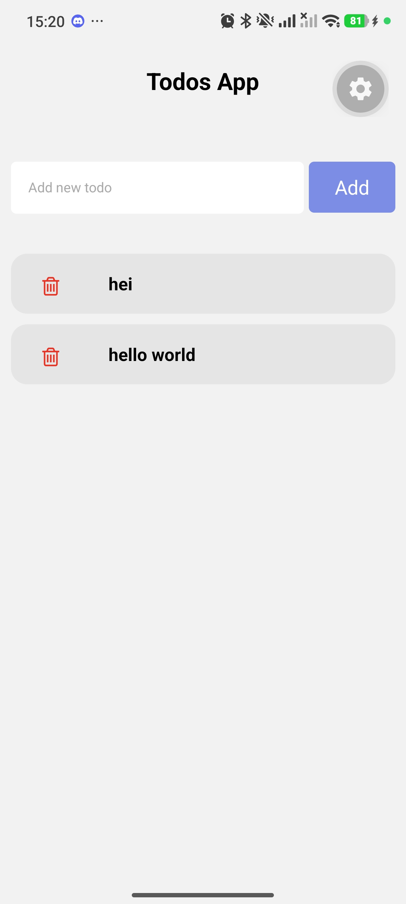
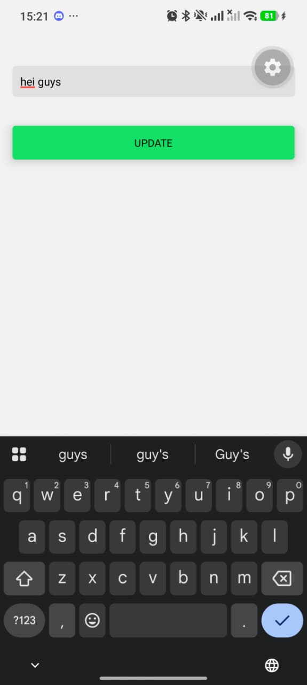
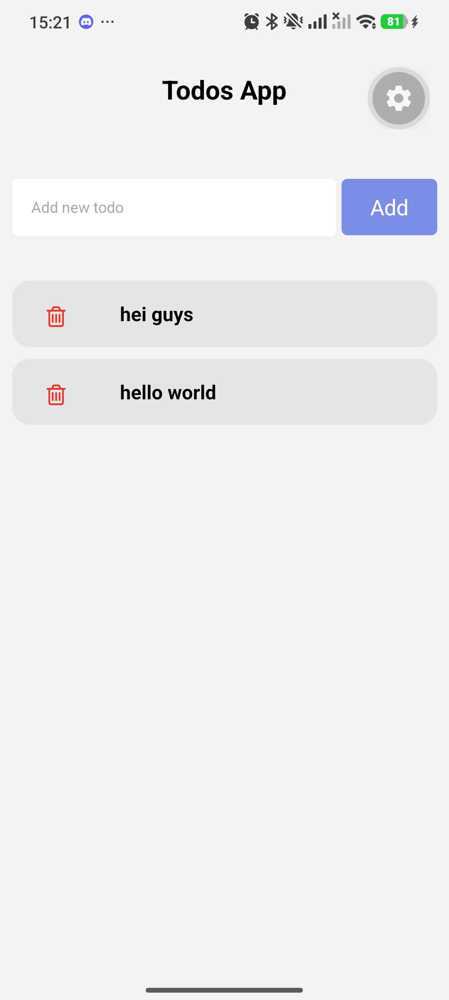
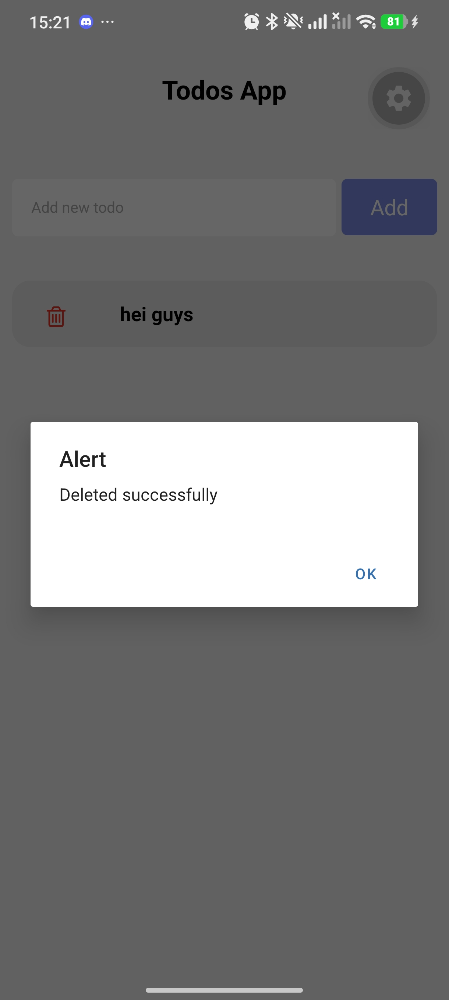
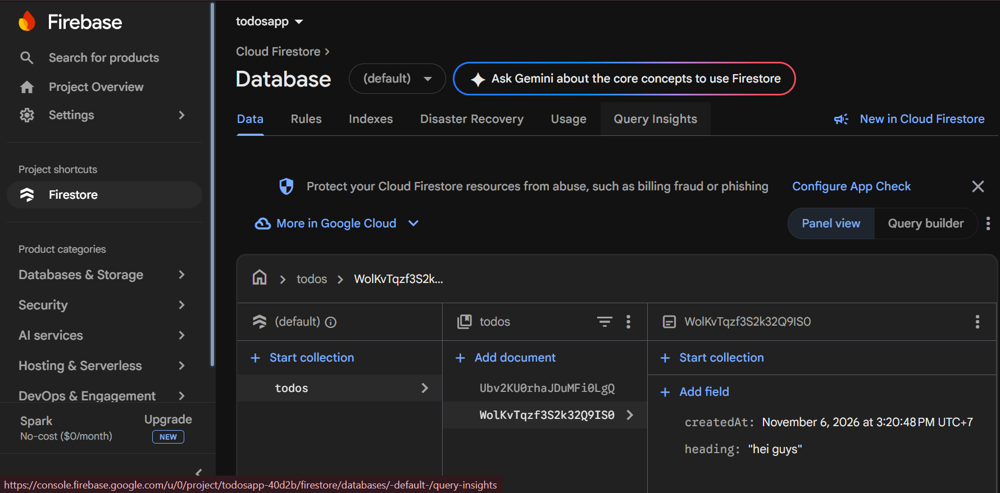

# TodosApp: Aplikasi CRUD dengan React Native, Expo, dan Firebase

Aplikasi daftar tugas (to-do list) sederhana yang dibuat untuk tugas
mata kuliah Mobile Programming. Aplikasi ini mendemonstrasikan operasi
**CRUD** (Create, Read, Update, Delete) dengan database online **Firebase Firestore**.

## Identitas

- Nama: Miraj Jamal Sidik
- NIM: 41155050240026
- Mata Kuliah: Mobile Programming

## Fitur

- **Create**: menambah todo baru lewat kolom input dan tombol Add.
- **Read**: menampilkan daftar todo dari Firestore secara realtime.
- **Update**: mengubah teks todo di layar Detail lalu menekan UPDATE.
- **Delete**: menghapus todo dengan menekan ikon tempat sampah.

## Teknologi

- React Native dan Expo
- Firebase Firestore (database)
- React Navigation (Stack Navigator)

## Cara Kerja Singkat

Aplikasi punya dua layar. Layar **Home** menampilkan daftar todo, form
tambah, dan tombol hapus. Saat sebuah todo ditekan, aplikasi pindah ke layar
**Detail** untuk mengedit teksnya. Semua data disimpan di collection `todos`
pada Firestore, sehingga perubahan langsung tampil di layar.

## Screenshot

### Daftar Todo

### Edit Todo

### Setelah Diedit

### Setelah Dihapus

### Data di Firestore

## Cara Menjalankan

1. Clone repository ini, lalu masuk ke foldernya.
2. Install dependensi: `npm install`
3. Buat project Firebase dan database Firestore, lalu isi konfigurasinya di `config.js`.
4. Jalankan aplikasi: `npx expo start`
5. Scan QR Code dengan aplikasi Expo Go.